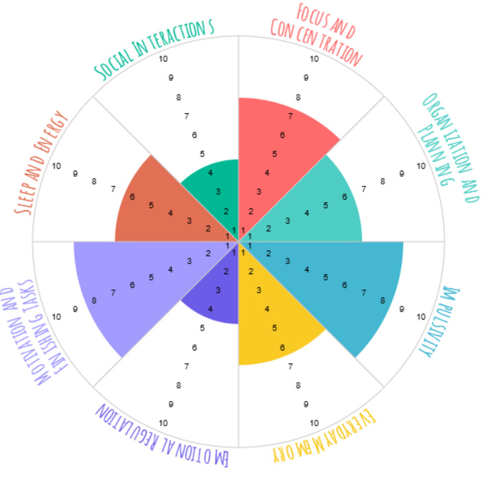

**Copyright © 2026. All rights reserved. Unauthorized copying, redistribution, sublicensing, or sale of this codebase, in whole or in part, is strictly prohibited.**

# Wheel of Life

A live demo is available https://resourcesof.life. 

Wheel of Life is an Angular application for creating visual life assessments, reflecting on priorities, and tracking progress over time.

The application is designed around a simple product progression:

1. A visitor can try the wheel without creating an account.
2. A personal user can save assessments and compare sessions over time - _not available in this demo_.
3. A coach can manage client wheels and share focused assessment links - _not available in this demo_.

Some authenticated functionality depends on the companion backend API - _not available in this demo_.




## Technology

- Angular 17.3 with standalone components, SSR, hydration, router guards, and typed reactive forms
- TypeScript 5.3 in strict mode
- RxJS 7.5
- NgRx Store and Effects 17
- Angular Material and CDK
- Chart.js with `ng2-charts`
- `ngx-translate` for runtime internationalization
- `ngx-markdown` and Marked for blog, legal, and note content
- Sentry for production diagnostics
- Jasmine and Karma for unit tests
- Playwright for browser-level tests
- ESLint, Prettier, Husky, and lint-staged
- Azure Pipelines, Docker, and Nginx for delivery


## Architecture

The project is an Angular 17 standalone application with strict TypeScript and strict template checking. Code is organized by product feature, with shared infrastructure kept outside feature folders.

```text
src/
  app/
    core/          # Cross-cutting infrastructure: errors, logging, interceptors
    features/      # Route and domain features
      personal/
      professional/
      wheel/
      user-profile/
      ...
    guards/        # Authentication, plan, and subscription access rules
    services/      # API access and application-wide services
    state/         # NgRx actions, reducers, effects, and selectors
    ui/            # Reusable presentational components
    utils/         # Pure mappers, validators, and utilities
  configs/         # Application, navigation, plan, and route configuration
  environments/    # Local and production API configuration
  assets/          # Translations, content, icons, and static media
```

Feature folders use nested `features/` and `ui/` directories where a workflow benefits from a container/presentational split. API calls are kept behind services and NgRx effects rather than being made directly by components.

### Key decisions and trade-offs

#### Standalone Angular composition

The application uses standalone components and `bootstrapApplication` instead of feature NgModules. This keeps dependencies visible at the component boundary and makes route-level code splitting straightforward. Shared providers are composed in `src/configs/app.config.ts` so the browser and server entry points can reuse the same application setup.

#### NgRx for shared domain state

NgRx manages wheel, personal-session, authentication, and GDPR state. These workflows span several routes, depend on asynchronous API operations, and need predictable transitions, so explicit actions and effects are justified despite their additional boilerplate. Local UI state remains in components and reactive forms rather than being promoted into the global store.

Selectors also own derived session history and trend calculations. This keeps transformation logic testable and prevents view components from duplicating business rules.

#### SSR, hydration, and prerendering

Public landing, legal, and blog pages benefit from crawlable HTML and useful initial metadata. Angular SSR and client hydration support that requirement, while prerendering produces static pages that can be served efficiently by Nginx.

The production container does not run a persistent Node SSR process. It builds the browser/server targets, prerenders known public routes, and serves the resulting static output from Nginx. This trades request-time personalization for simpler runtime operations, aggressive asset caching, and lower hosting overhead. Authenticated routes continue as a client-side application.

#### Selective lazy loading

Larger or less frequently visited route groups—such as account settings, session dashboards, registration, blog, and legal pages—are lazy loaded. Core entry routes remain eager to avoid adding an extra request to the most common first interaction.

#### Authentication and error handling

The application attempts silent session restoration during bootstrap. An authentication interceptor handles access-token concerns, while a separate global HTTP interceptor normalizes backend failures into application errors, records diagnostic context, shows user-facing notifications, and reports critical failures to Sentry.

Refresh credentials are expected to be held in an HTTP-only cookie; secrets and Sentry auth tokens must not be stored in committed environment files.


## Getting started

### Prerequisites

- Node.js 20.x
- npm
- A Chromium/Chrome installation for headless unit tests
- The backend API on `http://localhost:3000` for authenticated and persisted workflows

### Install and run

```bash
npm ci
npm start
```

Open `http://localhost:4200`.

The public wheel and static content can be explored without the backend. Login, account, persistence, professional, and subscription workflows require the API.

To point local development at another API, change `apiUrl` in `src/environments/environment.local.ts`. Do not place credentials or tokens in environment files.

## Quality checks

Run focused checks while developing, then run the complete set before submitting a change:

```bash
npm run lint
npm test -- --watch=false --browsers=ChromeHeadless
npm run build
```

Generate a local HTML coverage report with:

```bash
npm test -- --watch=false --browsers=ChromeHeadless --code-coverage
```

The report is written to `coverage/wheeloflife/`.

Playwright is configured for guest and authenticated Chromium projects. Authenticated tests expect a working backend and create reusable browser state during the `auth-setup` project.

```bash
npx playwright install chromium
npm run e2e
```

> **Current E2E path note:** `playwright.config.ts` uses `src/e2e` as its test directory, while the checked-in specifications currently live in `e2e`. Align the configuration and directory before relying on `npm run e2e` in automation.

The pre-commit hook runs ESLint and Prettier through lint-staged for changed TypeScript, HTML, SCSS, JSON, and Markdown files.

## Build and delivery

### Browser production build

```bash
npm run build
```

The `prebuild` hook regenerates the sitemap before Angular creates the optimized browser bundle.

### Local SSR development

```bash
npm run dev:ssr
```

### Production prerender pipeline

The production path is:

```text
Angular browser build + server build
                ↓
       prerender public routes
                ↓
       static assets and HTML
                ↓
             Nginx
```

`npm run build:ssr` uploads Sentry source maps as part of the command and therefore requires authorized Sentry configuration. Do not run it with production credentials unless a release upload is intended.

Azure Pipelines installs locked dependencies, runs unit tests and lint, builds/prerenders the application, creates an Nginx image, pushes it to GHCR, and promotes the image through development and production environments.

For bundle investigation:

```bash
npm run build:analyze
```

Production budgets are configured in `angular.json` for the initial bundle, component styles, and vendor code.

## Testing strategy

The test suite is organized by risk and responsibility:

- Component tests exercise rendered behavior and user interactions.
- Reducer and selector tests protect immutable state transitions and derived analytics.
- Effect tests verify asynchronous workflow orchestration.
- Service and interceptor tests cover API contracts, authentication behavior, and error paths.
- Guard tests cover access rules for authentication, plans, and subscriptions.
- Playwright tests cover navigation and header behavior for guest and authenticated states.

Tests should prefer DOM interactions and observable outcomes over direct calls to component methods. New interactive UI should include stable `data-testid` attributes where semantic queries alone are insufficient.

## Security and privacy

- Access to account, plan, and professional routes is enforced by composable router guards.
- Authentication and token refresh are centralized in an HTTP interceptor.
- Global API failures are normalized before reaching feature code.
- GDPR workflows include data export and account deletion.
- Local Sentry configuration, generated authentication state, coverage, and build output are ignored by Git.
- API keys, access tokens, refresh tokens, and Sentry auth tokens must never be committed.

Client-side guards improve navigation and user experience but are not an authorization boundary. The backend must independently validate authentication, plan entitlements, ownership, and client-link access.
